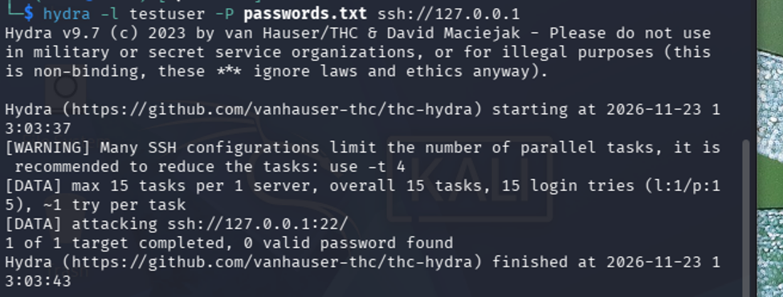
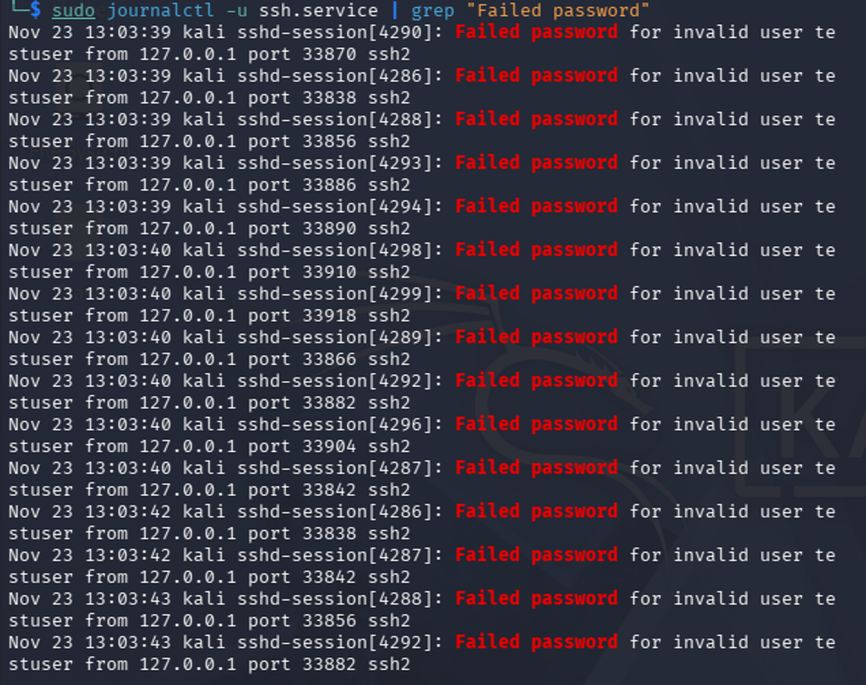
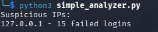
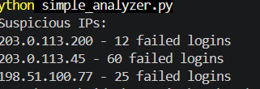

# SSH Brute-Force: Attack and Detect

| | |
|---|---|
| **Type** | Home lab (offense + defense) |
| **Tools** | Kali Linux, Hydra, journalctl, Python |
| **Environment** | Kali VM, localhost only (127.0.0.1) |

## Summary

I ran an SSH brute-force attack against my own Kali VM with Hydra, found the failed logins in the system journal, and caught the attack with a Python detector I wrote. Everything stayed on localhost, so no traffic left the VM and no real account was targeted. At the end I also run the detector on a larger sample log to show what it catches and what it misses.

## 1. Lab setup

I started the SSH service so there was something to attack:

```
sudo systemctl start ssh
```

Then I made a short list of fake passwords. A small list keeps the run quick, and since none of them are real, every attempt fails on purpose:

```
nano passwords.txt
```

## 2. The attack

I pointed Hydra at a fake `testuser` account on localhost:

```
hydra -l testuser -P passwords.txt ssh://127.0.0.1
```

`-l` sets one username and `-P` loads the password list. Hydra tried all 15 passwords and found none that worked, which is what I wanted. The goal was to generate failed logins, not to break in.



## 3. The evidence

Every failed attempt gets written to the system log. On Kali that's the systemd journal rather than the older `/var/log/auth.log`, so I pulled the SSH entries from there:

```
sudo journalctl -u ssh.service | grep "Failed password"
```

This is the same data a SOC analyst would look at after a suspected brute-force. There's a line for each attempt, all from 127.0.0.1 within a few seconds of each other. They also say `invalid user`, because `testuser` doesn't exist on the box.



## 4. Catching it with my detector

I saved those log lines to a file and ran [`simple_analyzer.py`](simple_analyzer.py) on it. It flagged 127.0.0.1 with 15 failed logins, matching the 15 attempts Hydra made:

```
python3 simple_analyzer.py
```



### How the script works

A failed SSH login line looks like this:

```
Oct 14 02:14:03 webserver sshd[4821]: Failed password for root from 203.0.113.45 port 51234 ssh2
```

The IP always comes right after the word `from`, so the script finds that word and takes the next one. That also works on the Kali lines, where `invalid user` adds extra words earlier in the line. It counts failures per IP in a dictionary and prints any IP at 10 or more. It only uses built-in Python.

```python
THRESHOLD = 10
failed_counts = {}

file = open("sample_auth.log", "r")

for line in file:
    if "Failed password" in line:
        words = line.split()
        spot = words.index("from")
        ip = words[spot + 1]
        if ip in failed_counts:
            failed_counts[ip] = failed_counts[ip] + 1
        else:
            failed_counts[ip] = 1

file.close()

print("Suspicious IPs:")
for ip in failed_counts:
    if failed_counts[ip] >= THRESHOLD:
        print(ip, "-", failed_counts[ip], "failed logins")
```

## 5. Testing it on a bigger sample log

The Hydra run only had one attacker, so I also ran the script on [`sample_auth.log`](sample_auth.log), a generated log in the real `auth.log` format. The IPs come from ranges reserved for documentation, so they aren't real hosts. It flagged three:



Reading the log for each one:

- `203.0.113.45`: 60 failures in about two minutes, cycling through `root`, `admin`, `test` and others. A classic automated attack.
- `198.51.100.77`: 25 failures on `devops`, then a successful login. This one matters most, since it probably guessed the password. I found that by reading the log, not from the script.
- `203.0.113.200`: 12 failures spread over a few hours. It got flagged, but only because the script never looks at time.

## Limitations

- **No time window.** 10 failures in a minute and 10 failures in a month look the same.
- **Doesn't catch the break-in.** It never checks whether a failing IP later logged in successfully, which is the worst case.
- **Hardcoded file name.** You can't point it at a different log yet.

## What I learned

- How Hydra runs an online SSH brute-force and how to read its output.
- Where failed logins land on a systemd-based system like Kali, and how to pull them with `journalctl`.
- That my detector works on real attack logs, not just the sample data I built it with.
- That a simple count can miss the most important event. The successful login in the sample log only showed up when I read it myself.
- Why keeping this kind of testing on localhost makes it safe and legal to run.
