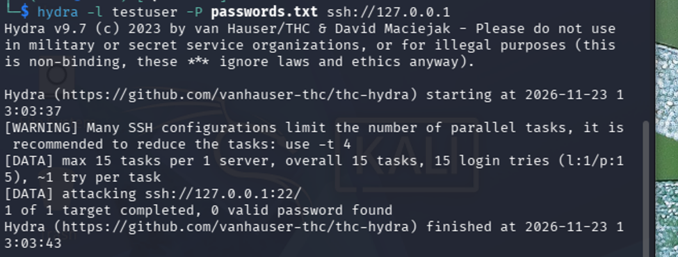
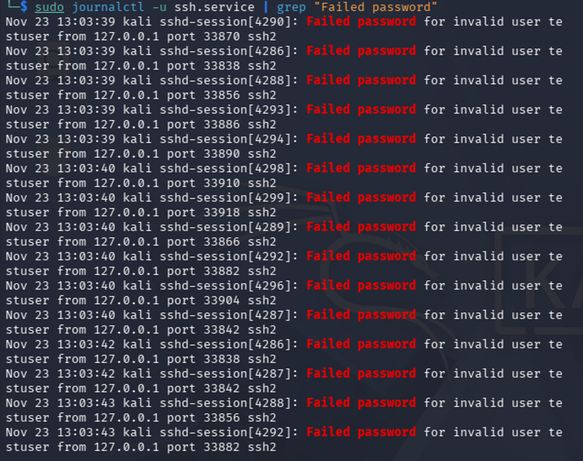
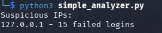

# SSH Brute-Force: Attack and Detect

| | |
|---|---|
| **Type** | Home lab (offense + defense) |
| **Tools** | Hydra, Python, Kali Linux |
| **Environment** | Isolated VM, localhost only (127.0.0.1) |

## Summary

I ran an SSH brute-force attack against my own machine with Hydra, then caught it with a Python log analyzer I wrote. The attack and the detection are two halves of the same event, so doing both shows what a brute-force looks like in the logs and how a simple detector picks it out. Everything ran on localhost inside a VM, so no traffic left the machine and no real account was targeted.

## Setup

I started the SSH service so there was something to attack:

```
sudo systemctl start ssh
```

Then I made a short list of fake passwords. A small list keeps the run quick, and none of them are real, so every attempt fails on purpose:

```
nano passwords.txt
```

## The attack

I pointed Hydra at a fake `testuser` account on localhost:

```
hydra -l testuser -P passwords.txt ssh://127.0.0.1
```

Hydra tried all 15 passwords and found none that worked, which is what I wanted. The goal was to generate failed logins, not to break in.



## The evidence

Every failed attempt gets written to the system log. On Kali that is the systemd journal rather than the older `/var/log/auth.log`, so I pulled the SSH entries from there:

```
sudo journalctl -u ssh.service | grep "Failed password"
```

This is the same log data a SOC analyst would look at after a suspected brute-force. Each line shows the failed login coming from 127.0.0.1.



## The detection

I saved those log lines to a file and ran my detector against it. The script reads each line, grabs the IP after the word `from`, counts failures per IP, and prints any IP over the threshold:

```python
THRESHOLD = 10
failed_counts = {}

file = open("sample_auth.log", "r")

for line in file:
    if "Failed password" in line:
        words = line.split()
        spot = words.index("from")
        ip = words[spot + 1]
        if ip in failed_counts:
            failed_counts[ip] = failed_counts[ip] + 1
        else:
            failed_counts[ip] = 1

file.close()

print("Suspicious IPs:")
for ip in failed_counts:
    if failed_counts[ip] >= THRESHOLD:
        print(ip, "-", failed_counts[ip], "failed logins")
```

It flagged 127.0.0.1 with 15 failed logins, matching the 15 attempts Hydra made:



## What I learned

- How Hydra runs an online SSH brute-force and what its output means.
- Where failed logins land on a systemd-based system, and how to read them with `journalctl`.
- That my detector works on real attack logs, not just the sample data I built it with.
- Why keeping the whole thing on localhost makes this kind of testing safe to run and legal.

This uses the same tool from my [SSH Brute-Force Detector](https://github.com/AidenPalladino/ssh-bruteforce-detector) project, tested here against a real attack.
